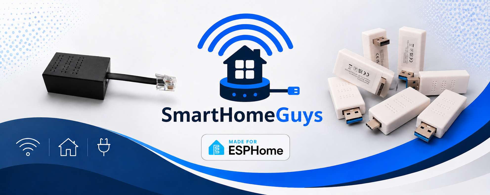

Welcome to SmartHomeGuys we’re a small UK based maker of smarthome hardware and design every device to solve a problem in our house and then open source it on here.

## The products
- DeskUp Pro - Controls a standing desk with an RJ12 socket with Home Assistant

  <a href="https://github.com/SmartHomeGuys/DeskUp-Pro-Controller-RJ12">Github Repo</a>&nbsp;&nbsp;&nbsp;&nbsp;
  <a href="https://smarthomeguys.uk/products/deskup-pro">Purchase on our store</a>&nbsp;&nbsp;&nbsp;&nbsp;

- DeskUp Pro Flexispot - Controls a Flexispot standing desk with Home Assistant

  <a href="https://github.com/SmartHomeGuys/DeskUp-Pro-Flexispot">Github Repo</a>&nbsp;&nbsp;&nbsp;&nbsp;
  <a href="https://smarthomeguys.uk/products/deskup-pro-flexispot">Purchase on our store</a>&nbsp;&nbsp;&nbsp;&nbsp;
  
- Bluetooth Proxy Stick for Home Assistant - No cable needed the USB is built in (straight and angled variations)

  <a href="https://github.com/SmartHomeGuys/Bluetooth-Proxy">Github Repo</a>&nbsp;&nbsp;&nbsp;&nbsp;
  <a href="https://smarthomeguys.uk/products/bluetooth-proxy-stick-for-home-assistant">Purchase on our store</a>&nbsp;&nbsp;&nbsp;&nbsp;
  
